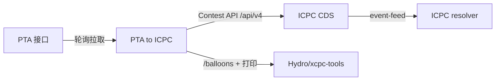

# PTA to ICPC

  

把 PTA (pintia.cn) 上账号已可见的比赛数据转译为 ICPC Contest API 2026-01 只读服务，供 ICPC CDS→resolver 与 xcpc-tools（气球/打印）消费。

> [!WARNING]
> 本项目仅为 **ICPC Contest API 协议研究与技术演示工具**。
> 它仅在本地读取账号已可见的比赛数据，将其转译为标准化竞赛接口。
> 
> 1. 本工具**仅用于技术学习、本地测试**；
> 2. 禁止在PTA生产环境，使用本工具举办正式竞赛；
> 3. 使用本工具自动化访问PTA服务，需自行遵守PTA的用户协议；
> 4. 自动化轮询PTA网页接口可能违反平台服务条款，使用者自行承担全部法律与账号风险；
> 5. 本项目不提供任何形式的生产环境可用性承诺，无技术支持。

PTA 官方另提供满足 Contest API 的付费服务，正式赛事建议直接采购或取得书面授权。

## 特性

- **Contest API 2026-01 + DOMjudge v4 超集**：全部接口挂在 `/api/v4/`；共享路径（contests/teams/organizations）用 DOMjudge 形状，其余集合保持 Contest API 形状。
- **event-feed / 冻结 / 自动定稿**：NDJSON 事件流、删除事件、封榜、比赛结束后按 `end + 5:00` 自动定稿；消费者读到 `end_of_updates` 后自行结束下载（EOF），不会超时。
- **气球端点**：每 (队伍, 题目) 首次 AC 一个气球，`balloonid` 只增、永不复用，供 xcpc-tools 稳定 upsert。
- **打印流水线**：扮演 DOMjudge，把打印题提交的源码按打印脚本的 multipart 形状 POST 到 `PRINT_SERVER`。
- **setup GUI**：一次性配置连接、题目颜色、自定义分组、打印题、座位/队员/教练、比赛时间覆盖。
- **PTA 限流自适应**：全局请求限速（带抖动）+ 每轮详情预算；429 触发冷却，不拖垮整轮。
- **持久化缓存**：每轮成功轮询后把快照写入 `manual/cache/state.json`（节流 + 原子写），重启时先服务未过期快照再增量刷新——重启即就绪，不再全量重拉详情、消除 429 尖峰（TTL / 开关可配）。
- **纯只读**：无任何写回 PTA 的端点，`capabilities` 为空。
- **HTTP Basic 认证**：`/api/v4/` 支持 HTTP Basic 认证（用户名固定 `admin`，密码由 setup 随机生成、可在「比赛设置」tab 改）；`/healthz` 与本机自检保持开放。
- **统一日志**：服务与 setup 的运行日志（含 uvicorn 启动与访问日志）按同一格式同时写入 stderr 与 `manual/pta2icpc.log`（5 MB × 3 大小轮转）。
- **Windows 单机可跑**：绑 `127.0.0.1`，单机部署。

## 架构与数据流



- PTA → PTA to ICPC：带 PTA cookie 轮询拉取提交/题目/队伍，翻译成 Contest API 对象并缓存。
- PTA to ICPC → CDS：CDS 以 `RESTContestSource` 消费 `/api/v4/` 并镜像事件流。
- CDS → resolver：定稿后 CDS 正常结束下载，resolver 无需 `--test` 即可运行。
- PTA to ICPC → Hydro/xcpc-tools：消费 `/balloons`（气球发放）与打印流水线。

## 环境要求

- Python 3.13+（见 `pyproject.toml`）。
- [uv](https://docs.astral.sh/uv/)（下文用 `uv run …`；`.venv` 由 uv 管理）。
- Windows。
- tkinter（Python 标准库，仅 setup GUI 需要）。
- 一个能查看该场比赛榜单的 PTA 账号 cookie（会过期，需覆盖整场比赛）。
- 可选：一个 DOMjudge 打印脚本端点（`PRINT_SERVER`）。

## 安装

```bash
uv sync
```

`uv sync` 会创建（或接管）`.venv` 并安装运行依赖与 `dev` 组（pytest）。在 `pta2icpc/` 目录下执行。

## 快速开始

1. **首次配置**：`uv run pta2icpc-setup` —— 一次性 GUI。首次弹出「比赛连接」对话框填 `contest_id` + PTA cookie（可选打印服务器 URL；比赛中要改可点顶栏「🔗 比赛连接…」）；再设置题目颜色 / 自定义分组 / 打印题 / 座位·队员·教练 / 比赛时间覆盖，保存后写出 `manual/contest/setup-*.json`。可重复运行。「比赛设置」tab 还会生成/保存 `manual/config/config.json` 的接口密码（`/api/v4/` Basic 认证，用户名 `admin`；可「随机重置」/「复制」）。

2. **启动服务**：在 `pta2icpc/` 目录下 `uv run pta2icpc`。

3. **自检**：`curl http://127.0.0.1:8000/healthz`。

4. **接入消费者**：
   
   CDS `ccsConfig.xml` 里的 `<ccs>` 元素：
   
   ```xml
   <ccs url="http://127.0.0.1:8000/api/v4/contests/<contest_id>" user="admin" password="<setup 生成的密码>"/>
   ```
   
   xcpc-tools `config.server.yaml`：
   
   ```yaml
   type: domjudge
   server: http://127.0.0.1:8000
   username: admin
   password: <setup 生成的密码>
   ```

## 配置

程序设置只有一个文件 `manual/config/config.json`。最小示例：

```json
{ "host": "127.0.0.1", "port": 8000, "api_password": "<setup 生成的密码>" }
```

字段表与目录布局见 `docs/configuration.md`。

## 文档

| 文件                        | 内容                            |
| ------------------------- | ----------------------------- |
| `docs/configuration.md`   | 设置文件、目录布局、运行要求                |
| `docs/api.md`             | `/api/v4/` 端点、事件流与定稿、气球契约     |
| `docs/data-and-setup.md`  | 数据来源与覆盖、setup GUI、打印流水线、语言 id |
| `docs/troubleshooting.md` | 常见问题                          |
| `docs/superpowers/specs/` | 设计文档（7 篇）                     |

## 开发

- 测试：`uv run python -B -m pytest -q -p no:cacheprovider`。
- 
- 规范：ICPC Contest API 2026-01（https://ccs-specs.icpc.io/2026-01/）；实现说明见 `docs/superpowers/specs/`。

## 相关项目与致谢

- [ICPC Contest API 2026-01](https://ccs-specs.icpc.io/2026-01/) —— 本项目实现的接口规范。
- [ICPC Tools](https://github.com/icpctools/icpctools)（[CDS](https://tools.icpc.global/cds/) / Resolver）—— 主要消费方。
- [DOMjudge](https://github.com/DOMjudge/domjudge)（[官网](https://www.domjudge.org/)）—— `/api/v4/` 与 balloons 形状的参考。
- [Hydro/xcpc-tools](https://github.com/hydro-dev/xcpc-tools) —— 气球 / 打印消费方（下文简称 xcpc-tools）。
- [laobuzhang/PTA_BALL](https://github.com/laobuzhang/PTA_BALL) —— 本项目脱胎的参考项目。
