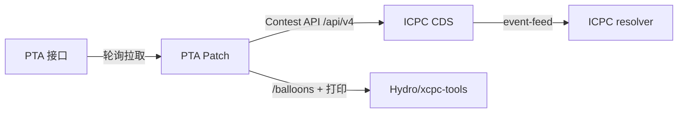

# PTA Patch

  

把 PTA (pintia.cn) 上账号已可见的比赛数据转译为 ICPC Contest API 2026-01 只读服务，供 ICPC CDS→resolver 与 xcpc-tools（气球/打印）消费。

> [!WARNING]
> 本项目仅为 **ICPC Contest API 协议研究与技术演示工具**。
> 它仅在本地读取账号已可见的比赛数据，将其转译为标准化竞赛接口。
>
> 1. 本工具**仅用于技术学习、本地测试**；
> 2. 禁止在PTA生产环境，使用本工具举办正式竞赛；
> 3. 使用本工具自动化访问PTA服务，需自行遵守PTA的用户协议；
> 4. 自动化轮询PTA网页接口可能违反平台服务条款，使用者自行承担全部法律与账号风险；
> 5. 本项目不提供任何形式的生产环境可用性承诺，无技术支持。

PTA 官方另提供满足 Contest API 的付费服务，正式赛事建议直接采购或取得书面授权。

## 特性

- **Contest API 2026-01 + DOMjudge v4 超集**：全部接口挂在 `/api/v4/`；共享路径（contests/teams/organizations）用 DOMjudge 形状，其余集合保持 Contest API 形状。
- **event-feed / 冻结 / 自动定稿**：NDJSON 事件流、删除事件、封榜、比赛结束后按 `end + 5:00` 自动定稿；消费者读到 `end_of_updates` 后自行结束下载（EOF），不会超时。
- **气球端点**：每 (队伍, 题目) 首次 AC 一个气球，`balloonid` 只增、永不复用，供 xcpc-tools 稳定 upsert。
- **打印流水线**：扮演 DOMjudge，把打印题提交的源码按打印脚本的 multipart 形状 POST 到 `PRINT_SERVER`。
- **setup GUI**：一次性配置连接、题目颜色、自定义分组、打印题、座位/队员/教练、比赛时间覆盖。
- **PTA 限流自适应**：全局请求限速 + 每轮详情预算；429 触发冷却，不拖垮整轮。
- **纯只读**：无任何写回 PTA 的端点，`capabilities` 为空。
- **Windows 单机可跑**：绑 `127.0.0.1`，无认证。

## 架构与数据流



- PTA → PTA Patch：带 PTA cookie 轮询拉取提交/题目/队伍，翻译成 Contest API 对象并缓存。
- PTA Patch → CDS：CDS 以 `RESTContestSource` 消费 `/api/v4/` 并镜像事件流。
- CDS → resolver：定稿后 CDS 正常结束下载，resolver 无需 `--test` 即可运行。
- PTA Patch → Hydro/xcpc-tools：消费 `/balloons`（气球发放）与打印流水线。

## 环境要求

- Python 3.13+（见 `pyproject.toml`）。
- Windows（下文命令用 `.venv/Scripts/python`；Linux/macOS 请改为 `.venv/bin/python`）。
- tkinter（Python 标准库，仅 setup GUI 需要）。
- 一个能查看该场比赛榜单的 PTA 账号 cookie（会过期，需覆盖整场比赛）。
- 可选：一个 DOMjudge 打印脚本端点（`PRINT_SERVER`）。

## 安装

```bash
python -m venv .venv
.venv/Scripts/python -m pip install -e ".[dev]"
```

## 快速开始

1. **首次配置**：`.venv/Scripts/python -m ptapatch.setup` —— 一次性 GUI。首次弹出「比赛连接」对话框填 `contest_id` + PTA cookie（可选打印服务器 URL；比赛中要改可点顶栏「🔗 比赛连接…」）；再设置题目颜色 / 自定义分组 / 打印题 / 座位·队员·教练 / 比赛时间覆盖，保存后写出 `manual/contest/setup-*.json`。可重复运行。

2. **启动服务**：在 `ptapatch/` 目录下 `.venv/Scripts/python -m ptapatch`（没有模块级 `app`，不能用 `uvicorn ptapatch.app:app`）。

3. **自检**：`curl http://127.0.0.1:8000/healthz`、`curl http://127.0.0.1:8000/api/v4/`。

4. **接入消费者**（片段里不放任何真实凭据）：
   
   CDS `ccsConfig.xml` 里的 `<ccs>` 元素：
   
   ```xml
   <ccs url="http://127.0.0.1:8000/api/v4/contests/<contest_id>" user="ptapatch" password="none"/>
   ```
   
   xcpc-tools `config.server.yaml`：
   
   ```yaml
   type: domjudge
   server: http://127.0.0.1:8000
   ```

## 配置

程序设置只有一个文件 `manual/config/config.json`（缺失即全部默认）。最小示例：

```json
{ "host": "127.0.0.1", "port": 8000 }
```

字段表与目录布局见 `docs/configuration.md`。所有命令必须在 `ptapatch/` 目录下运行（路径为相对路径）。

## 文档

| 文件                         | 内容                            |
| -------------------------- | ----------------------------- |
| `docs/configuration.md`    | 设置文件、目录布局、运行要求                |
| `docs/api.md`              | `/api/v4/` 端点、事件流与定稿、气球契约     |
| `docs/data-and-setup.md`   | 数据来源与覆盖、setup GUI、打印流水线、语言 id |
| `docs/troubleshooting.md`  | 常见问题                          |
| `docs/superpowers/specs/`  | 设计文档（5 篇）                     |

设计文档：`docs/superpowers/specs/2026-10-13-ptapatch-design.md`、`2026-10-15-print-domjudge-design.md`、`2026-10-15-domjudge-balloons-design.md`、`2026-10-15-v4-unify-design.md`、`2026-10-15-cds-finalize-design.md`。

## 开发

- 测试：`.venv/Scripts/python -B -m pytest -q -p no:cacheprovider`（`-B -p no:cacheprovider` 避免留下 `__pycache__`/`.pytest_cache`）。
- 项目结构：`ptapatch/`（服务：`app`/`config`/`paths`/`poller`/`store`/`translate`/`scoreboard`/`event_feed`/`balloons`/`printjob`/`models`/`timefmt`/`setup`/`diag_balloons` + `pta/` 子包）、`tests/`（pytest，逐模块对应）。
- 规范：ICPC Contest API 2026-01（https://ccs-specs.icpc.io/2026-01/）；实现说明见 `docs/superpowers/specs/`。

## 相关项目与致谢

- [ICPC Contest API 2026-01](https://ccs-specs.icpc.io/2026-01/) —— 本项目实现的接口规范。
- [ICPC Tools](https://github.com/icpctools/icpctools)（[CDS](https://tools.icpc.global/cds/) / Resolver）—— 主要消费方。
- [DOMjudge](https://github.com/DOMjudge/domjudge)（[官网](https://www.domjudge.org/)）—— `/api/v4/` 与 balloons 形状的参考。
- [Hydro/xcpc-tools](https://github.com/hydro-dev/xcpc-tools) —— 气球 / 打印消费方（下文简称 xcpc-tools）。
- [laobuzhang/PTA_BALL](https://github.com/laobuzhang/PTA_BALL) —— 本项目脱胎的参考项目。
